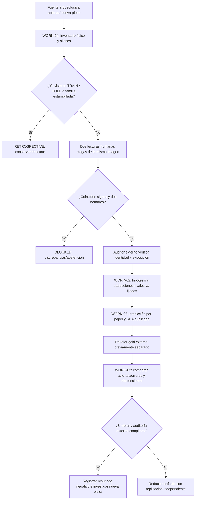

# SCI-CORE-05 · Circuito operativo de predicción y posible traducción

**Hilo principal:** IberOS demostración científica · **prioridad:** predicción de rasgos ibéricos y contraste de posibles traducciones. **Gasto autorizado: 0 €**. No existe autorización para contratar API, infraestructura o ediciones de pago.

## Contrato científico

Las funciones automatizan **procesos auditables**, no «desciframientos» automáticos. Se distinguen cuatro estados:
1. **RETROSPECTIVE**: inscripción ya conocida, fuente/editorial comparada, o posibilidad de fuga. Solo aporta hipótesis y controles, **no** prueba prospectiva.
2. **BLOCKED_EVIDENCE**: identidad, imagen, lecturas o contexto sin comprobar. **Nunca** rellenar con datos estimados.
3. **READY_FOR_EXTERNAL_ADMISSION_AUDIT**: expediente documental internamente completo, pero **sin certificación de independencia**; está prohibido sellar automáticamente.
4. **PREDICTION_LOCKED / UNBLINDED**: solo después de auditoría de anterioridad, doble lectura, precompromiso del Core y evaluación de roles externos. El software produce una comparación *contra gold declarado*, sin validar por sí mismo una traducción.

## Workflows: una sola línea de avance



### Procesos ya ejecutables en GitHub

| Función/archivo | Entrada | Salida y salvaguarda |
| --- | --- | --- |
| `scientific_candidate_intake.audit` | `data/review/sci_pred04_candidate_queue_v1.json` | Candidatos rechazados/bloqueados/pendientes de auditoría; prohíbe introducir papeles GOLD al predictor |
| `scripts/scientific_core_works_status.py` | cola + `SCI-PRED-02` | un JSON con estados de WORK-01 a WORK-05, razones de bloqueo y **0 aciertos confirmados** mientras no haya fuente externa |
| `prospective_role_lock.seal` | caso ciego tras auditoría, sin papeles GOLD | `statement_sha256` y predicciones H-MAKER/H-COMMISSIONER; aun así requiere commit y sellado temporal externo verificable |
| `prospective_role_evaluation.compare_trial` | predicción congelada + etiquetas desveladas después | acierto/error/declaración de discrepancia, nunca validación automática |
| `prospective_role_evaluation.evaluate_cohort` | primeros 20 pares independientes, baseline fijado de TRAIN | cobertura, abstenciones, fallos, umbral de candidatura pendiente de arbitraje científico |
| `scripts/evaluate_prospective_roles.py` | argumentos opcionales explícitos; **jamás lee gold oculto sin permiso** | informe `INSUFFICIENT_N` cuando no recibe datos reales |

### Ejecuciones reproducibles

Con Python 3.12, dependencias públicas de IberOS y GitHub Actions estándar:

```bash
python -m pip install -e . pytest
python -m pytest -q tests/test_scientific_candidate_intake.py tests/test_scientific_core_works_status.py
python -m iberos.scientific_candidate_intake --input data/review/sci_pred04_candidate_queue_v1.json --output /tmp/sci-pred04-intake.json
python scripts/scientific_core_works_status.py --output /tmp/sci-core-works-status.json
python scripts/evaluate_prospective_roles.py --output /tmp/sci-pred03-empty-gold.json
```

Todos los informes se escriben en `/tmp`, nunca sobrescriben fuentes. La ejecución sin muestra evaluable debe mostrar `INSUFFICIENT_N`, no una supuesta precisión lingüística.

### Primer lote documental de verificación

La cola `sci_pred04_candidate_queue_v1.json` contiene únicamente **siete expedientes RETROSPECTIVE** (Caminreal, Andelo, Sagunto, familia K.5.4, estela de Badalona, plomo de Xàbia/CIRNE y plomo de Masies de Sant Miquel). Se conservan para detectar reutilizaciones y duplicaciones, **no** se presentan como nuevas piezas ni como un GOLD lingüístico. Una fórmula conocida de `-te` no demuestra quién hizo la obra; una comparación latina puede sugerir funciones pero no aporta automáticamente una traducción.

### Works verificables en GitHub

- **WORK-01** #149: normalización de corpus, lectura revisada y predicción de caracteres contra baseline.
- **WORK-02** #150: traducciones posibles rivales, regla estable `-te` y condiciones de refutación.
- **WORK-03** #151: evaluación ciega, falsos positivos/negativos, abstenciones, réplica y manuscrito.
- **WORK-04** #157: incorporación de pieza realmente nueva sin duplicados y doble lectura independiente.
- **WORK-05** #158: separación de gold externo, publicación del compromiso previo y contraste de papeles.

Ninguno se cierra por superar CI. Para cerrar WORK-04/05 debe existir un objeto físico admisible, con evidencia primaria, identidad conciliada, revisores independientes y posibilidad de contrastar **sin circularidad** los dos roles externos.

### Tratamiento de resultados negativos

No se ocultan registros con lecturas ilegibles, abstenciones, discrepancias, duplicados o predicciones erróneas. Un candidato rechazado mantiene su fuente y motivo; un modelo que no supere a TRAIN solo permite un resultado negativo o inconcluso. El antiguo `FULL3406` y los indicadores `CORE=27/45`, `ICS=70.8` permanecen congelados; no son porcentajes de lengua descifrada.

**Siguiente hito obligatorio:** obtener la primera pieza nueva con imagen cotejable y dos papeles extralingüísticos independientes, sin utilizar la respuesta externa para corregir la hipótesis ya sellada. Sin material nuevo, ningún laboratorio de software por sí solo alcanzará ese hito.
